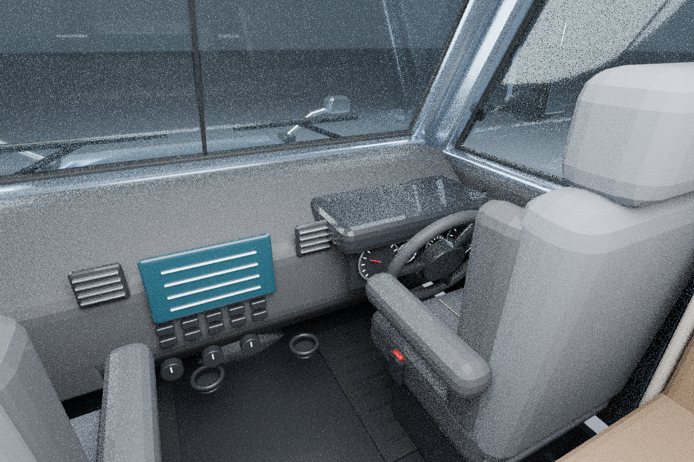
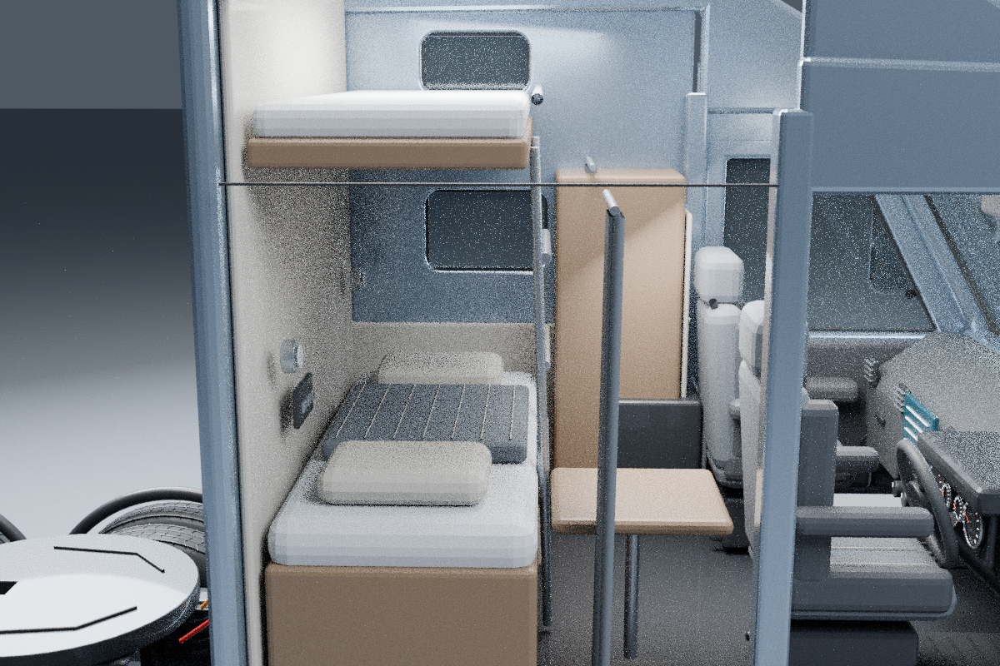
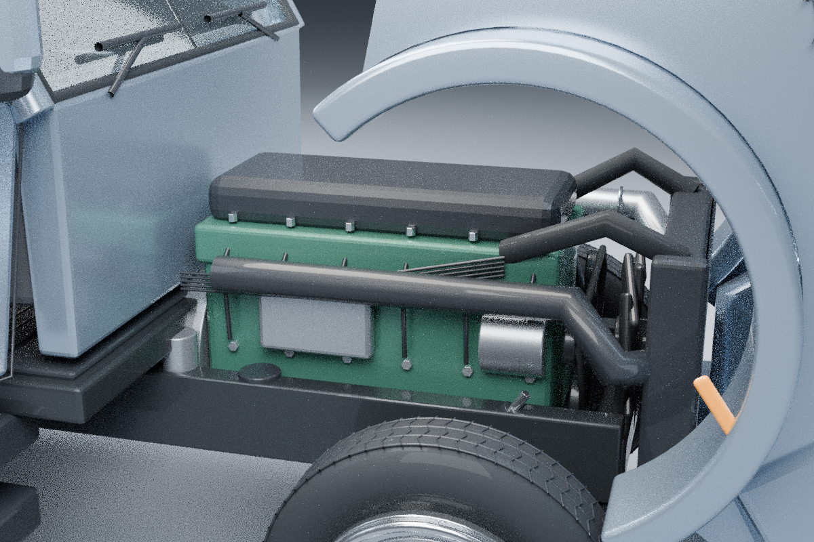

# Volvo VNL 760 — модель v2

Процедурная 3D-модель по фотографиям для Blender 4.3.2. Обновлены передняя облицовка, бампер, блок-фары и зеркала; добавлены салон, спальный отсек и технические узлы. Геометрия и размеры приблизительные: это не заводская CAD-модель и не полностью фотореалистичная копия.


## Содержимое

- `models/Volvo_VNL_760.blend` — редактируемая сцена с деталями по коллекциям, материалами, освещением и камерами.
- `models/Volvo_VNL_760.glb` — статическая модель в закрытом состоянии, без студии.
- `scripts/build_v2.py` — актуальный скрипт построения модели.
- `scripts/render_views.py` — рендер салона, спальника и двигателя.
- `scripts/build.py`, `scripts/fix.py` — исходные скрипты первой версии, сохранены для истории.

В модели есть кресла с ремнями и подлокотниками, торпедо с приборами и органами управления, руль, педали, дверная обивка, две спальные полки, шкафы, столик, холодильник и лестница. Под капотом: приблизительная внешняя геометрия рядного шестицилиндрового двигателя, турбокомпрессора, фильтров, патрубков, радиатора, вентилятора и навесного оборудования. Также добавлены коробка передач, кардан, мосты, рессоры, пневмоподушки и седельное устройство. Внутренние движущиеся детали двигателя не моделировались.

## Просмотр в Blender

Откройте BLEND. Кадр **1** — закрытые двери и капот; кадр **80** — двери и капот открыты. Камеры `Exterior camera`, `Interior camera`, `Sleeper camera`, `Engine camera` показывают соответствующие зоны. Детали разделены по коллекциям.

## Генерация

```sh
blender -b -t 8 --python scripts/build_v2.py
blender -b -t 8 --python scripts/render_views.py
```

Результаты сохраняются в `models/` и `previews/`. Для другого пути используйте `VOLVO_OUTPUT`, `VOLVO_PREVIEWS`, а при повторном рендере — `VOLVO_MODEL`. Параметры `OPEN_HOOD`, `OPEN_DOORS` и `HIDE_ROOF` находятся в начале скрипта.

## Салон



## Спальный отсек — сечение

Ближняя боковина и шкаф скрыты только на этом рендере для обзора спальных мест.



## Двигатель



Материалы без внешних текстур. Модель не подготовлена для 3D-печати.
