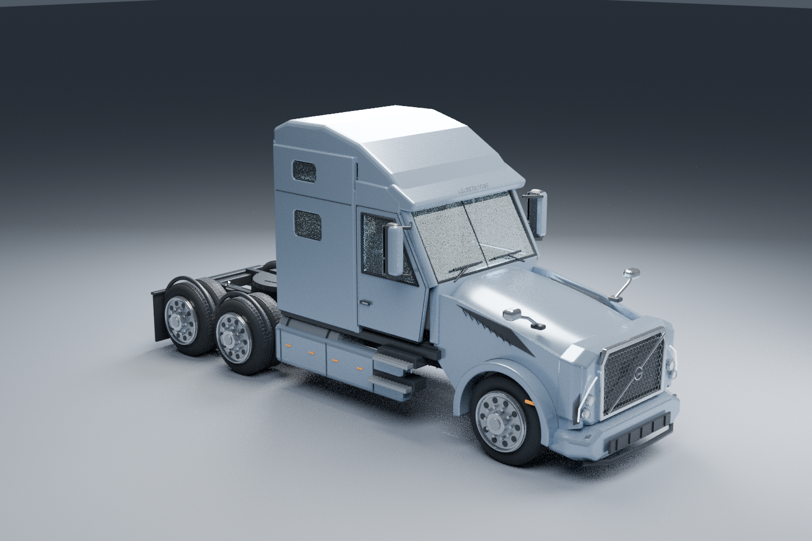

# Volvo VNL 760

Упрощённая 3D-модель по фотографиям, созданная в Blender 4.3.2. Пропорции приблизительные, интерьер отсутствует. Модель не подготовлена для 3D-печати.



## Файлы

- `models/Volvo_VNL_760.blend` — редактируемая сцена, материалы и освещение.
- `models/Volvo_VNL_760.glb` — экспорт модели с материалами без студии.
- `previews/Volvo_VNL_760_preview.png` — рендер итоговой модели.
- `scripts/build.py` — создание базовой геометрии и сцены.
- `scripts/fix.py` — исправление положения лобового стекла и итоговый экспорт.

## Повторная генерация

Из корня репозитория выполните последовательно:

```sh
blender -b --python scripts/build.py
blender -b --python scripts/fix.py
```

Скрипты сохраняют результаты в `models/`, включая повторно созданное превью. Размеры оценены по фото; длина около 8,4 м.
