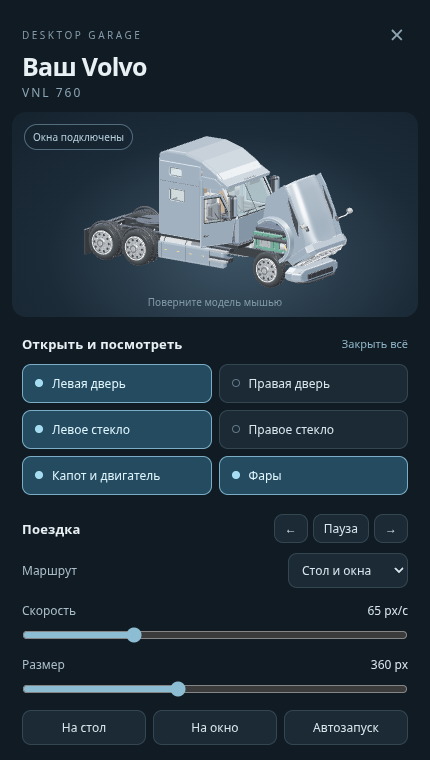

# Volvo Desktop — Windows 10/11

Отдельное приложение с нашей 3D-моделью Volvo VNL 760 поверх рабочего стола. Это самостоятельное приложение Windows, а не питомец внутри ChatGPT.



## Готовое приложение

Откройте вкладку **Actions** в репозитории и последний успешный запуск **Build Volvo Desktop for Windows**. В разделе **Artifacts** скачайте `Volvo-Desktop-Windows-x64`, распакуйте архив и запустите файл `Volvo-Desktop-0.1.0-x64.exe`. Вход в GitHub нужен для скачивания артефакта. Node.js и Blender для готового EXE не требуются.

Альтернатива: распаковать вложенный ZIP целиком и запустить `Volvo Desktop.exe` внутри него. Не переносите этот EXE отдельно от остальных файлов ZIP. Готовая сборка не подписана цифровой подписью.

## Управление

- Грузовик автоматически ездит по нижней границе рабочей области и верхним видимым границам открытых окон, над которыми хватает места для грузовика.
- Перетащите грузовик мышью. После отпускания он переедет на ближайшую подходящую границу ниже.
- Щёлкните по двери, стеклу или капоту для открытия и закрытия.
- Двойной щелчок или **Ctrl + Alt + T** открывает гараж с вращаемой 3D-моделью и кнопками управления.
- Правая кнопка мыши или значок в системном трее открывает меню.
- В гараже можно независимо открыть обе двери, опустить стёкла, поднять капот, включить фары, изменить размер и скорость.
- Наведение мыши, открытые двери, капот и гараж останавливают движение. Опущенные стёкла движению не мешают.
- Кнопки **На окно** и **На стол** меняют маршрут. Узкие, закрытые, свёрнутые и полностью перекрытые окна не используются.
- При перемещении окна грузовик следует за его границей; при закрытии — переезжает на нижнюю доступную опору.
- Прозрачные участки окна приложения пропускают щелчки к приложениям под ним.
- **Выход** находится в гараже и в меню трея. Закрытие гаража возвращает грузовик к поездке.

Работа с окнами использует координаты Win32, без чтения текста или содержимого окон. Приложение работает локально. Автозапуск выключен по умолчанию и включается отдельной кнопкой.

## Запуск из исходников

Установите Node.js 22 LTS или новее и откройте `Start.cmd`, либо:

```powershell
cd desktop
npm ci
npm start
```

Сборка EXE: `Build-Windows.cmd`, либо `npm run dist:win`. Файлы появятся в `desktop/dist`. Сборка также настроена в GitHub Actions.

## Проверки

```powershell
npm test
```

Тесты проверяют доступные границы окон, перекрытия, отрицательные координаты мониторов, разворот, перенос вместе с окном, закрытие окна, а также независимую работу дверей, стёкол, капота и колёс в настоящем GLB. Интерфейс дополнительно проверяется через Playwright (`npm run test:ui`, путь к Chromium задаётся `CHROMIUM_PATH`).

Исходный BLEND сохранён в `../models`. Для приложения подготовлен отдельный `app/assets/truck.glb.gz`: статические детали объединены по материалам, подвижные узлы и десять колёс сохранены отдельными группами.

Повторная подготовка модели:

```powershell
blender -b --python scripts/prepare-model.py
```

Проверка пользовательских мониторов, конкретного масштабирования DPI, политики PowerShell и поведения поверх разных приложений требует запуска на целевом Windows. На Linux доступны тесты логики и 3D-интерфейса; нативные границы окон включаются только на Windows. Это первая рабочая версия приложения.
