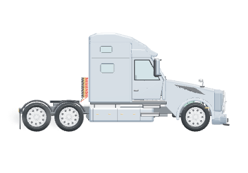
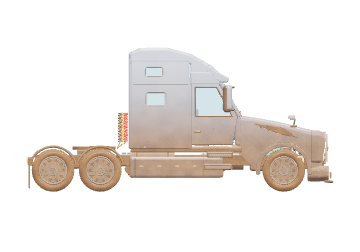

# Volvo Desktop — Windows 10/11

Отдельное приложение с нашей 3D-моделью Volvo VNL 760 поверх рабочего стола. Это самостоятельное приложение Windows, а не питомец внутри ChatGPT.


## Готовое приложение

Откройте вкладку **Actions** в репозитории и последний успешный запуск **Build Volvo Desktop for Windows**. В разделе **Artifacts** скачайте `Volvo-Desktop-Windows-x64`, распакуйте архив и запустите файл `Volvo-Desktop-0.3.0-x64.exe`. Вход в GitHub нужен для скачивания артефакта. Node.js и Blender для готового EXE не требуются.

Альтернатива: распаковать вложенный ZIP целиком и запустить `Volvo Desktop.exe` внутри него. Не переносите этот EXE отдельно от остальных файлов ZIP. Готовая сборка не подписана цифровой подписью.

## Новое в 0.3.0

В панели появились отдельные вкладки **Управление** и **Состояние**. «Состояние» показывает текущее действие, маршрут, двери, стёкла, капот, фары, пробег, чистоту, масло, двигатель и выбранное колесо. Здесь же находятся мойка, ТО и замена колёс. Открыть этот раздел можно напрямую пунктом «Состояние грузовика» в контекстном меню.

При наведении на грузовик на рабочем столе он остаётся на месте, вращает задние ведущие колёса и выпускает небольшой дымок из-под шин. Передние колёса не буксуют. После ухода мыши дым рассеивается и поездка продолжается. Даже переезд между границами на время наведения замирает. При перетаскивании, открытом управлении, паузе, ремонте, критическом износе или открытых дверях/капоте пробуксовка не включается. Пробег от неё не растёт.



## Новое в 0.2.0

- На рабочем столе камера строго сбоку. У края грузовик останавливается, плавно разворачивается и едет обратно. В гараже сохранено свободное вращение модели.
- ЛКМ по грузовику, кнопка «Посигналить», меню трея или **Ctrl + Alt + H** включают двухтональный звуковой сигнал. Громкость регулируется в гараже. Для распознавания двойного щелчка одиночный щелчок звучит с задержкой около 0,5 секунды.
- Ресурс масла, двигателя и каждого из десяти колёс расходуется только при езде. Пробег и состояние сохраняются между запусками. Это условная игровая модель износа.
- ТО длится 12 секунд: открывается капот, восстанавливаются масло и двигатель. Состояние шин при ТО не сбрасывается.
- Замена выбранного колеса длится 7 секунд, колесо снимается и устанавливается обратно, ресурс только этого колеса восстанавливается.
- Во время обслуживания грузовик стоит. При критическом остаточном ресурсе поездка останавливается до обслуживания.
- ТО и замену видимого переднего колеса можно запустить прямо через контекстное меню на рабочем столе; выбор любого другого колеса доступен в гараже.

## Чистота и мойка

Пока приложение запущено, каждые 10 минут чистота снижается на одну шестую: 100 → 83 → 67 → 50 → 33 → 17 → 0%. Через час кузов покрывается сильной грязью; пауза движения этому не мешает. При закрытом приложении время не накапливается. Процент и остаток десятиминутного интервала сохраняются.



«Помыть» доступно в гараже и в меню по правому щелчку на рабочем столе. Мойка длится 6 секунд: появляется вода, грязь постепенно исчезает, чистота становится 100%, десятиминутный отсчёт начинается заново. Мойка не восстанавливает масло, двигатель или шины.

## Управление

- Грузовик автоматически ездит по нижней границе рабочей области и верхним видимым границам открытых окон, над которыми хватает места для грузовика.
- Перетащите грузовик мышью. После отпускания он переедет на ближайшую подходящую границу ниже.
- Один щелчок левой кнопкой по грузовику включает звуковой сигнал. Перетаскивание не сигналит; двойной щелчок открывает гараж. Двери, стёкла и капот управляются кнопками гаража.
- Двойной щелчок или **Ctrl + Alt + T** открывает гараж с вращаемой 3D-моделью и кнопками управления.
- Правая кнопка мыши или значок в системном трее открывает меню.
- В гараже можно независимо открыть обе двери, опустить стёкла, поднять капот, включить фары, изменить размер и скорость.
- Наведение мыши, открытые двери, капот и гараж останавливают движение. Опущенные стёкла движению не мешают.
- Кнопки **На окно** и **На стол** меняют маршрут. Узкие, закрытые, свёрнутые и полностью перекрытые окна не используются.
- При перемещении окна грузовик следует за его границей; при закрытии — переезжает на нижнюю доступную опору.
- Прозрачные участки окна приложения пропускают щелчки к приложениям под ним.
- **Выход** находится в гараже и в меню трея. Закрытие гаража возвращает грузовик к поездке.

Работа с окнами использует координаты Win32, без чтения текста или содержимого окон. Приложение работает локально. Автозапуск выключен по умолчанию и включается отдельной кнопкой.

## Запуск из исходников

Установите Node.js 22 LTS или новее и откройте `Start.cmd`, либо:

```powershell
cd desktop
npm ci
npm start
```

Сборка EXE: `Build-Windows.cmd`, либо `npm run dist:win`. Файлы появятся в `desktop/dist`. Сборка также настроена в GitHub Actions.

## Проверки

```powershell
npm test
```

Тесты проверяют доступные границы окон, перекрытия, отрицательные координаты мониторов, разворот, перенос вместе с окном, закрытие окна, а также независимую работу дверей, стёкол, капота и колёс в настоящем GLB. Интерфейс дополнительно проверяется через Playwright (`npm run test:ui`, путь к Chromium задаётся `CHROMIUM_PATH`).

Исходный BLEND сохранён в `../models`. Для приложения подготовлен отдельный `app/assets/truck.glb.gz`: статические детали объединены по материалам, подвижные узлы и десять колёс сохранены отдельными группами.

Повторная подготовка модели:

```powershell
blender -b --python scripts/prepare-model.py
```

Проверка пользовательских мониторов, конкретного масштабирования DPI, политики PowerShell и поведения поверх разных приложений требует запуска на целевом Windows. На Linux доступны тесты логики и 3D-интерфейса; нативные границы окон включаются только на Windows. Версия приложения — 0.3.0.
